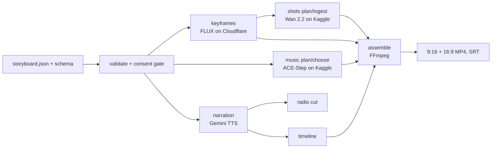

# ARCHITECTURE.md

## Shape

`storyboard.json` is the **only contract**. Every stage reads it, writes files under `outputs/`, appends to `runs.jsonl`,
and records an input hash in `outputs/manifest.json`. Stages never call each other's internals; they share files and
`pipeline/common.py` (paths, hashing, cache, retries, logging) and `pipeline/timeline.py` (timing).

## Contracts

| Stage | Reads from storyboard | Writes | Cache key (hash of) |
|---|---|---|---|
| validate | everything | exit code | n/a (fast) |
| narration | `shots[].narration.text`, `language`, `config.tts` | `narration/sNN.wav` | text, model, voice, style, language |
| keyframes | `style`, `characters`, `shots[].keyframe_prompt`, `seed`, `config.keyframe` | `keyframes/sNN.jpg` | composed prompt, model, steps, size, seed, golden-reference file |
| shots | `shots[].motion_prompt`, `seed`, `config.video` + keyframe file | `kaggle/jobs.json`, `clips/sNN.mp4` + sidecar | keyframe file hash, motion prompt, seed, video params |
| music | `music.cues[]` | `kaggle/music_jobs.json`, `music/chosen/<cue>.wav` | plan is cheap; choice is explicit (`choices.jsonl` keeps the reason) |
| assemble | all of the above + `end_card`, `config.mix/output` | `final/*.mp4`, `film.srt` | per segment: source file hash, camera, duration, size |

Timing is derived, not stored: a shot lasts `max(duration_s, narration + lead_in + tail)` (`timeline.py`), so the voice sets the pace.

## Caching

`is_fresh(key, hash, path)` is true only if the output exists **and** was built from the same inputs. Consequence: edit one
shot and only that shot's narration/keyframe/clip/segment is rebuilt; the Wan clip also goes stale when its keyframe changes.
`tests/test_pipeline.py` asserts this (a re-run makes zero new model calls; two edited shots regenerate exactly two calls).

## Failure handling

| Failure | Handling |
|---|---|
| 429 / 5xx / network | `with_retries`: exponential backoff, honours `Retry-After`, 3 attempts, attempts logged |
| Daily quota exhausted | `QuotaError`: stage stops cleanly, logs `status: quota`, keeps everything cached; re-run after reset continues where it stopped |
| Endpoint rejects `seed` | keyframes retry without it and log `seed_sent: false` (reproducibility caveat recorded) |
| Wan clip missing/stale/failed/OOM | up to 3 attempts in the notebook, then **Ken Burns** fallback from the keyframe; film still renders |
| No keyframe | labelled placeholder frame, loud warning |
| No chosen score | temp track + warning that it is not an original score |
| Invalid storyboard / real person without consent | pipeline refuses to start (`validate.py`) |
| Notebook session timeout | notebooks write each shot as it finishes and skip finished shots on restart |

## Degradation ladder (what the film looks like when things fail)

Wan clip -> Ken Burns on keyframe -> placeholder frame. A narrated, scored, subtitled sequence of stills is still a film.

## Audio chain

narration (per-shot WAV, placed at `start + lead_in`) -> pre-level to -16 LUFS; score cues placed on their shot ranges with
crossfades -> pre-level to -20 LUFS; `sidechaincompress` (threshold 0.02, ratio 6, attack 300 ms, release 1500 ms) ducks music
under the voice; sum; two-pass `loudnorm` to -14 LUFS / -1 dBTP; AAC 192k. Values live in `config.mix`.

## Local showcase & family web app (`pipeline/web.py` + `web/`)

`make web` starts a zero-dependency local HTTP studio (`http://127.0.0.1:8000`) serving `web/` with byte-range MP4 streaming,
a storyboard/telemetry inspector, music selection, and a no-code **Tell Your Story** form (`story.md` export or `storyboard.draft.json`).
Sensitive files (`.env`, `.git`, `.venv`, `*.key`) are explicitly blocked.

## Why these choices (decisions worth explaining in the interview)

- **JSON contract + schema** instead of CLI args: one shot can be edited and explained; seeds and prompts are never hidden in code.
- **Square master frames, two crops**: one set of keyframes/clips serves both aspect ratios (cost: upscaling for vertical).
- **Plan/ingest for GPU stages**: the GPU is borrowed and slow, so the pipeline cannot block on it.
- **Fallback instead of failure**: the film must exist at every point of the project; quality improves as stages succeed.
- **Deterministic assembly**: FFmpeg is not AI, so the same inputs give the same film.
