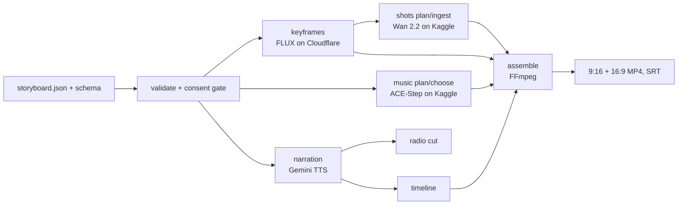

# Report: The Heritage Short — *ተስፋ አለመቁረጥ (Never Give Up)*

> **Project:** 70.0 s Amharic short film with English subtitles, original AI score, AI end card, and a reproducible `storyboard.json`-driven pipeline exported in `9:16` (`1080×1920`) and `16:9` (`1920×1080`).  
> **Note on pending screening:** User Test 2 (near-final cut screening) is left clearly marked for completion before final public posting so no unverified quotes are fabricated.

---

## 1. What I set out to make, and for whom

I built **ተስፋ አለመቁረጥ (Never Give Up)**, a 70.0-second single-character Amharic short film with English subtitles about a young Ethiopian man (**Yonas**) who fails repeatedly late at night, reaches the point of quitting, remembers a close friend's encouragement (*"Failure is not the end; as long as there is hope, there is a new beginning"*), and starts again at sunrise.

- **Who it is for:** Young Ethiopians in their teens and twenties who feel discouraged when hard work, studies, or projects do not succeed immediately ([DESIGN.md](DESIGN.md) Section 1).
- **Where they watch:** Vertically (`9:16`) on a phone in Telegram/WhatsApp groups, TikTok, or YouTube Shorts, alongside a `16:9` horizontal master.
- **Intended feeling:** Quiet relief and renewed courage to try once more tomorrow.
- **Constraints:** Zero paid API billing (free-tier Gemini API, Cloudflare Workers AI, and Kaggle `T4 x2` GPU), 3-day timeline, and a strict reproducibility contract around [storyboard.json](storyboard.json).

---

## 2. What I learned from my audience

### User Test 1 (Radio Cut — `outputs/final/radio_cut.mp4`, tested against commit `3eb6789`)
After generating the Amharic narration (`Charon` voice) and ducked temp music, I shared `radio_cut.mp4` on Telegram with **three friends** in my target audience ([DESIGN.md](DESIGN.md) Section 3):

1. **Roble (friend, target audience, Telegram):** *"It is good."* — Confirmed the overall pacing and story arc landed cleanly without pictures.
2. **Tesfa (friend, target audience, Telegram):** *"Also it is very good, keep it up."* — Confirmed the encouraging tone resonated.
3. **Yaread (friend, native Amharic speaker, Telegram):** *"It is good, but fix the word issue: instead of 'ችግሮችን' it would be better to say 'ችግሮች'."*

### Storyboard diff from User Test 1
Because of Yaread's native-speaker feedback, I changed `shots[0].narration.text` (`s01`) in [storyboard.json](storyboard.json) from `"አንድ ወቅት ብዙ ችግሮችን ያጋጠመው ወጣት ነበር።"` to `"አንድ ወቅት ብዙ ችግሮች ያጋጠመው ወጣት ነበር።"` and regenerated **only `s01`** (`runs.jsonl` `2026-11-26T00:02:43+0300`, `audio_s: 4.55`, leaving `s02`–`s09` cached).

### One thing the audience taught me that I would not have found alone
Written Amharic text can look grammatically fine on paper yet sound stiff when spoken aloud by TTS: the accusative `-ን` suffix on `ችግሮችን` before `ያጋጠመው` only jumped out as unnatural when a native speaker listened to the radio cut (`DESIGN.md` Section 5).

### User Test 2 (Near-final cut — `outputs/final/film_vertical_9x16.mp4` & `film_horizontal_16x9.mp4`)
*TODO (to fill after showing the newly assembled Wan 2.2 + ACE-Step 1.5 `9:16` and `16:9` MP4s to 3+ audience members on a phone and recording their quotes in [DESIGN.md](DESIGN.md) Section 4).*

---

## 3. The hardest problem and how I solved it

The hardest part of the project was **three stacked integration failures across the free model endpoints** ([FAILURES.md](FAILURES.md)):

1. **TTS double-wrapping & English instruction spoken aloud (`F01`, `F02`):**
   - *Symptom:* Every `gemini-3.8-flash-tts` clip initially began with an English voice reading `"Say this warmly..."` (`10.2–13.1 s` per clip, `runs.jsonl` `2026-11-25T20:04:42–20:06:15`) and ended with a `1.000` full-scale static burst (`~0.16 s`).
   - *What I tried & fixed:* Inspected `pipeline/narration.py` and the raw audio bytes of `s01.wav`. Found two root causes: (a) `gemini-3.8-flash-tts` treats `parts[].text` as verbatim speech, so `style_instruction` had to move into `speech_metadata` (with fallback to plain text) and `voice` switched from female `Kore` to male `Charon`; (b) Gemini returned a complete `RIFF....WAVE` container carrying a `7,656 B` trailing `C2PA` provenance chunk, which `audio.write_pcm_wav()` wrapped inside a *second* WAV header—turning the inner header and C2PA metadata into audible static. Unwrapping the inner `RIFF` payload locally fixed all 9 WAVs (`last 200 ms peak` dropped from `1.000` to `0.0008–0.0738`) with **zero extra API calls** while keeping C2PA provenance intact.
2. **Wan 2.2 TI2V-5B OOM and 34-minute latency on Kaggle T4 (`F05`, `E07`):**
   - *Symptom:* `enable_model_cpu_offload()` crashed with `OutOfMemoryError` at step `0/30` on all 9 shots (`2026-11-26T19:58`); switching to `enable_sequential_cpu_offload()` made `s01` succeed at `bfloat16 / 81 frames / 30 steps`, but took **`2040.8 s` (`34.01 GPU-min`)**—which would take 4.5 hours for the remaining 8 shots and miss the deadline.
   - *What I tried & fixed:* Switched `s02`–`s09` to native T4 `float16` with `49 frames` and `20 steps` plus `PYTORCH_CUDA_ALLOC_CONF=expandable_segments:True` and `vae.enable_slicing()`. Runtime dropped **8.1×** to **`248.7–256.0 s` (`4.14–4.27 GPU-min/shot`, `2.12–2.13 GB` peak VRAM)** with zero NaNs or black frames (`first_frame_mean = 34.2–106.5`).

Other real blockers resolved along the way: Gemini TTS 429 daily limits (`F01`/`E06`), `gemini-3.8-flash` HTTP 503 (`F03`, solved with `gemini-3.5-flash-lite` fallback in `pipeline/judge.py`), and Kaggle Python 3.13 incompatibility with `ACE-Step-1.5` (`F04`, solved by provisioning Python 3.11 via `uv` and updating to the `AceStepHandler` + `generate_music` API).

---

## 4. Suggested practices, tested honestly

- **A practice that beat my instinct — Reference sheet before keyframes + logging every call:**
  My first `make reference` batch (`2026-11-26T00:10`) produced 2D cartoon turnaround sheets with a fake artist signature (`Mea.H`). Catching that on 4 cheap reference images before generating 9 keyframes—and pivoting `style_block` to 35mm live-action photography (`E01`)—produced `4.71/5` mean identity consistency and `5.00/5` style consistency (`E02`, `runs.jsonl` `2026-11-26T04:06`) without training a LoRA. Likewise, `runs.jsonl` immediately exposed the TTS preamble (`12.0 s` for 31 chars) and `seed_sent: false` (`E03`).
- **A practice/default that did not work as assumed — Default `bfloat16` and `enable_model_cpu_offload()` on T4:**
  The scaffold's default `config.video` (`bfloat16`, `81` frames, `30` steps) with `enable_model_cpu_offload()` OOM'd immediately on a 15 GB Kaggle T4 (`F05`), and even with sequential offload `bfloat16` was 8.1× slower than `float16 / 49f / 20 steps` (`E07`). Measuring `s01` first saved the deadline.

---

## 5. Curiosity beyond the floor

1. **Family Story Studio & Showcase Web App ([web/](web/) + [pipeline/web.py](pipeline/web.py), `make web`):**
   Built a zero-dependency web frontend where a non-coding relative can enter a family story, choose language/voice, check the real-person consent gate, and export `story.md` or draft `storyboard.draft.json`, alongside a showcase player (`9:16` phone bezel, `16:9` wide, `radio_cut`) with HTTP byte-range seeking and live `runs.jsonl` telemetry.
2. **T4 Precision & Memory Optimization (`E07`):**
   Measured `bfloat16` (`2040.8 s`, `5.81 GB` peak VRAM) vs `float16` (`248.7–256.0 s`, `2.12–2.13 GB` peak VRAM) across all 9 shots, verifying frame brightness programmatically (`34.2–106.5`) rather than guessing whether `float16` produced black frames.
3. **Objective Music Candidate Measurement (`E08`, `E09`):**
   Measured LUFS and LRA across all 6 ACE-Step candidates (`c1_cand1`: `-19.14 LUFS`, `LRA 5.3` vs `c1_cand3`: `-15.09 LUFS`, `LRA 12.9`), confirming why `c1_cand1` sits cleanest under narration, and unified `radiocut.py` + `assemble.py` on `config.mix.music_prelevel_lufs = -20` to fix a `-31.1 LUFS` too-quiet temp track.

---

## 6. Pipeline in brief

Every stage reads [storyboard.json](storyboard.json) (validated by [schema/storyboard.schema.json](schema/storyboard.schema.json) and the consent gate in [pipeline/validate.py](pipeline/validate.py)), caches outputs by input SHA-256 hash in `outputs/manifest.json`, and logs every model call to [runs.jsonl](runs.jsonl). Heavy GPU stages (`shots`, `music`) use an explicit `plan -> notebook -> ingest/register` loop with graceful fallbacks (`Wan clip -> Ken Burns -> placeholder`; `chosen score -> temp track`).

---

## 7. Cost and time (from [COSTS.md](COSTS.md))

Across **72 real model/tool calls** in `runs.jsonl`, total measured model/FFmpeg runtime was **84.8 minutes** (**68.5 GPU-minutes**: `67.4` on Wan 2.2 TI2V-5B and `1.1` on ACE-Step 1.5). Using verified public list prices ([pipeline/pricing.json](pipeline/pricing.json), checked `2026-11-26`), the full film's list-price equivalent—including all retries and re-takes—is **\$0.7431 USD** (89.2% Wan 2.2 GPU time), while actual cash spent was **\$0.00**.

---

## 8. Consent, labelling, licences (from [ETHICS.md](ETHICS.md))

- **Consent:** `Yonas` is a fictionalised single character (`real_person: false`) with stock Gemini voice `Charon` and zero private family names/photos sent to external APIs ([ETHICS.md](ETHICS.md) Sections 1 & 4).
- **Labelling & provenance:** Both exports end with a 3-second *"Made with AI"* end card, `audio.write_pcm_wav()` preserves Gemini's `C2PA` metadata chunks (`F02`), no living artist names appear in prompts, and the public social post uses the platform's AI-content disclosure switch.
- **Licences:** Wan 2.2 TI2V-5B (Apache 2.0), FLUX.1 schnell (Apache 2.0), ACE-Step 1.5 (MIT, commercial outputs allowed), Gemini API terms checked on `2026-11-26`.

---

## 9. What I would build next

1. **Wire `pipeline/web.py` end-to-end with one-click keyframe + Ken Burns generation** so non-coding relatives using the `Tell Your Story` form get a complete downloadable MP4 without touching the terminal.
2. **Generate 16:9 / 9:16 native-aspect keyframes or two-pass upscaling** for the vertical export instead of centre-cropping square `480×480` Wan clips to `1080×1920`.
3. **Add `ffprobe` / waveform boundary checks** in `pipeline/narration.py` to catch silence-tail anomalies automatically on future TTS models.

---

## Evidence index

| Claim | Where |
|---|---|
| Audience, intent, User Test 1 (Roble, Tesfa, Yaread) & `s01` diff | [DESIGN.md](DESIGN.md) Sections 1, 3, 5; commit `3eb6789` |
| `s01` single-shot regeneration (`4.55 s`, `chars: 30`) | `runs.jsonl` `2026-11-26T00:02:43+0300`; `outputs/manifest.json` |
| Style pivot & `4.71/5` identity / `5.00/5` style consistency | `EXPERIMENTS.md` `E01`, `E02`; `runs.jsonl` `2026-11-26T04:06` |
| TTS preamble + `RIFF/C2PA` unwrapping fix | `FAILURES.md` `F01`, `F02`; `pipeline/narration.py`, `pipeline/audio.py` |
| Gemini 503 fallback & Kaggle Python 3.13 / Wan OOM fixes | `FAILURES.md` `F03`, `F04`, `F05`; `pipeline/judge.py`, `notebooks/` |
| 8.1× Wan `float16` speedup (`34.0 min` vs `4.2 min/shot`) | `EXPERIMENTS.md` `E07`; `outputs/clips/s01..s09.json` |
| Final loudness `-14.47 LUFS`, `-0.99 dBTP`, `70.0 s` | `outputs/mix/loudness_report.json`, `outputs/final/render_report.json` |
| Measured cost (`68.5 GPU-min`, `\$0.7431` list price, `\$0.00` spent) | [COSTS.md](COSTS.md), [pipeline/pricing.json](pipeline/pricing.json), `make costs` |
| Family Story Web App (`make web`) | [web/index.html](web/index.html), [pipeline/web.py](pipeline/web.py) |
